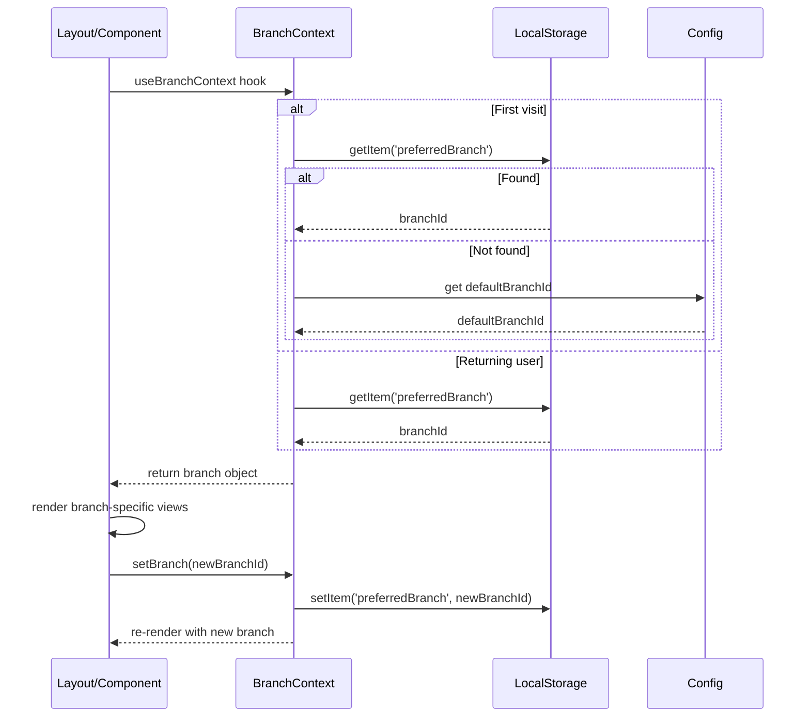

# Design: HU2 - Branch Management

## Technical Approach

The approach involves extending the existing data model to support multiple branches while maintaining backward compatibility where possible. Key aspects:

1. **Data Model Changes**:
   - Add `Branch` entity with essential fields (id, name, address, phone, email, isActive, timestamps)
   - Create `BranchInventory` junction table to store stock levels per product per branch
   - Modify `Product` model: remove global `stock` field (replaced by branch-specific inventory)
   - Add `branchId` foreign key to `Purchase` and `Sale` models to track which branch the transaction occurred at
   - Maintain existing relationships and indexes where applicable

2. **Backend Changes**:
   - Create new Server Actions for Branch CRUD operations (`src/actions/branch.ts`)
   - Modify existing Product, Purchase, and Sale actions to handle branch context:
     - Product actions: remove direct stock manipulation, use branch inventory operations
     - Purchase actions: require branchId, update inventory via branch-specific stock
     - Sale actions: require branchId, deduct inventory from branch-specific stock
   - Enhance Prisma queries to include branch filtering where relevant
   - Implement database transactions for stock operations to ensure consistency

3. **Frontend Changes**:
   - Create new Branch management UI under `/sucursales` route (list, create, edit views)
   - Add BranchSelector component for selecting branch in forms (purchases, sales, etc.)
   - Modify existing pages to include branch context:
     - Dashboard: add branch selector and filter metrics by selected branch
     - Productos: show branch-specific stock levels instead of global stock
     - Inventario: show branch-specific inventory
     - Compras/Ventas: require branch selection before processing
   - Implement Branch Context provider (`src/lib/context/BranchContext.ts`) to manage selected branch state
   - Update middleware to maintain branch context across requests where appropriate

4. **State Management**:
   - Use React Context for client-side branch selection state
   - Persist branch preference in localStorage/user settings for default selection
   - Ensure server actions receive branchId explicitly for security

5. **API Contracts**:
   - All existing action signatures updated to require branchId where relevant
   - New branch CRUD actions follow same patterns as existing actions
   - Error handling and validation maintained consistently

## Architecture Decisions

### Decision: Branch Inventory Modeling Approach
**Choice**: Junction table (`BranchInventory`) between Product and Branch
**Alternatives Considered**:
1. Add `branchId` to Product model (would require duplicating products per branch)
2. Add JSON field to Product for stock per branch (poor queryability, no indexing)
3. Separate Inventory model with composite keys (chosen approach)
**Rationale**: 
- Junction table provides normalized structure
- Enables efficient querying of stock levels by branch or product
- Supports future expansion (warehouses, locations)
- Maintains product entity as shared catalog across branches
- Allows proper indexing on foreign keys

### Decision: Stock Update Mechanism
**Choice**: Explicit inventory adjustments via branch-specific stock updates
**Alternatives Considered**:
1. Direct stock field on Product with branch filtering (would break existing single-stock assumption)
2. Compute stock on-the-fly from transaction history (performance issues with large datasets)
3. Trigger-based stock updates (complexity, debugging difficulties)
**Rationale**:
- Explicit updates mirror current pattern but scoped to branch
- Maintains consistency with existing transactional stock updates
- Enables auditing and reconciliation possibilities
- Clear separation of concerns: transactions modify inventory, not product entity

### Decision: Branch Context Propagation
**Choice**: Explicit branchId parameter in relevant Server Actions + React Context for UI
**Alternatives Considered**:
1. Global middleware setting branch per request (too rigid, doesn't support cross-branch operations)
2. URL-based branch scoping (e.g., /sucursal/1/productos) (SEO complications, complex routing)
3. Header-based context (not suitable for server actions)
**Rationale**:
- Explicit parameters ensure security and clarity
- Context provides seamless UX for branch selection
- Maintains compatibility with existing action patterns
- Allows operations that span multiple branches when needed (e.g., transfers)

### Decision: Migration Strategy
**Choice**: Single default branch for existing data
**Alternatives Considered**:
1. Leave existing data without branch assignment (would break queries requiring branch)
2. Prompt user to assign existing data to branches during migration (complex UX)
3. Create branch per existing user/complex mapping (over-engineering)
**Rationale**:
- Simple, predictable migration
- Preserves all existing data
- Provides clean starting point for multi-branch tracking
- Aligns with typical SMB use case (single branch initially)

## Data Flow

### Product Stock Update Flow (Purchase Example)
```mermaid
sequenceDiagram
    participant UI as Purchase Form
    participant Action as registerPurchase Action
    participant Prisma as Prisma ORM
    participant DB as Database

    UI->>Action: submit(formData with branchId, items)
    Action->>Prisma: transaction begin
    Params: branchId, items[{productId, quantity, price}]
    Params->>Prisma: create Purchase record (with branchId)
    Params->>Prisma: create PurchaseItem records
    Loop each item
        Params->>Prisma: update Product stock via BranchInventory increment
    End
    Params->>Prisma: transaction commit
    Prisma-->>Action: return result
    Action->>UI: success response
```

### Stock Query Flow (Inventory Page)
```mermaid
sequenceDiagram
    participant UI as Inventory Page
    participant Action as getProducts Action
    participant Prisma as Prisma ORM
    participant DB as Database

    UI->>Action: getProducts()
    Note over Action: Uses current branch from context
    Action->>Prisma: query BranchInventory joined with Product
    Params: where branchId = currentBranch
    Params->>DB: SELECT ... FROM BranchInventory JOIN Product ...
    DB-->>Prisma: return stock levels per product
    Prisma-->>Action: return products with branchStock
    Action->>UI: return product data
    UI->>UI: display stock for current branch
```

### Branch Selection Flow


## File Changes

| File | Action | Description |
|------|--------|-------------|
| `prisma/schema.prisma` | Modify | Add Branch model, BranchInventory junction table, update Product (remove stock, add relation), add branchId to Purchase and Sale |
| `src/actions/branch.ts` | Create | Server Actions for branch CRUD (create, get, update, delete, list) |
| `src/actions/product.ts` | Modify | Remove direct stock handling; add branch-scoped inventory methods; update validation |
| `src/actions/purchase.ts` | Modify | Require branchId parameter; update inventory via BranchInventory; adjust validation |
| `src/actions/sale.ts` | Modify | Require branchId parameter; update inventory via BranchInventory; adjust validation |
| `src/actions/inventory.ts` | Create | New actions for branch inventory operations (get stock, adjust stock, etc.) |
| `src/lib/validations/branch.ts` | Create | Zod validation schemas for branch data |
| `src/components/ui/BranchManager.tsx` | Create | Main branch management interface (list, create, edit, delete) |
| `src/components/ui/BranchSelector.tsx` | Create | Reusable component for branch selection (dropdown with search) |
| `src/app/sucursales/page.tsx` | Create | Branch management page (list view) |
| `src/app/sucursales/[id]/page.tsx` | Create | Branch detail/edit page |
| `src/lib/context/BranchContext.ts` | Create | React context for managing selected branch state |
| `src/app/layout.tsx` | Modify | Add BranchContext provider at root level |
| `src/app/dashboard/page.tsx` | Modify | Add branch selector; modify metrics queries to filter by branch |
| `src/app/productos/page.tsx` | Modify | Display branch-specific stock; add branch selector to product filters |
| `src/app/inventario/page.tsx` | Modify | Show inventory for selected branch; add branch selector |
| `src/app/clientes/page.tsx` | Modify | Add branch context where relevant (e.g., sales history) |
| `src/app/ventas/page.tsx` | Modify | Require branch selection for new sales; show branch in sales list |
| `src/app/compras/page.tsx` | Modify | Require branch selection for new purchases; show branch in purchase list |
| `src/middleware.ts` | Modify | Enhance to maintain and propagate branch context from cookies/session |
| `package.json` | Modify | Add any new dependencies (e.g., date-fns for formatting) |
| `src/lib/utils.ts` | Create/` | Add helper functions for branch operations if needed |

## Interfaces / Contracts

### Branch Entity (Prisma Model)
```prisma
model Branch {
  id            Int      @id @default(autoincrement())
  name          String
  address       String?
  phone         String?
  email         String?
  isActive      Boolean  @default(true)
  createdAt     DateTime @default(now())
  updatedAt     DateTime @updatedAt
  inventory     BranchInventory[]
  purchases     Purchase[] @relation("BranchPurchases")
  sales         Sale[]     @relation("BranchSales")
}

model BranchInventory {
  id          Int      @id @default(autoincrement())
  branchId    Int
  branch      Branch   @relation(fields: [branchId], references: [id], onDelete: Cascade)
  productId   Int
  product     Product  @relation(fields: [productId], references: [id], onDelete: Cascade)
  stock       Int      @default(0)
  lastUpdated DateTime @updatedAt

  @@unique([branchId, productId])
  @@index([branchId])
  @@index([productId])
}
```

### Modified Product Model (excerpt)
```prisma
model Product {
  // ... existing fields except stock removed
  inventory   BranchInventory[]
  purchaseItems PurchaseItem[]
  saleItems     SaleItem[]
}
```

### Modified Purchase Model (excerpt)
```prisma
model Purchase {
  // ... existing fields
  branchId    Int
  branch      Branch @relation(fields: [branchId], references: [id])
  // ... existing relations
}
```

### Modified Sale Model (excerpt)
```prisma
model Sale {
  // ... existing fields
  branchId    Int
  branch      Branch @relation(fields: [branchId], references: [id])
  // ... existing relations
}
```

### Branch Server Actions Interface
```typescript
// src/actions/branch.ts
export async function createBranch(data: unknown): Promise<ActionResponse<Branch>>
export async function getBranches(): Promise<ActionResponse<Branch[]>>
export async function getBranchById(id: number): Promise<ActionResponse<Branch>>
export async function updateBranch(data: unknown): Promise<ActionResponse<Branch>>
export async function deleteBranch(data: unknown): Promise<ActionResponse<Success>>
export async function getBranchOptions(): Promise<ActionResponse<{ id: number; name: string }[]>> // For dropdowns
```

### Product Inventory Interface (updated)
```typescript
// src/actions/product.ts
export async function getProductStock(productId: number, branchId: number): Promise<ActionResponse<number>>
export async function adjustProductStock(productId: number, branchId: number, change: number): Promise<ActionResponse<{ newStock: number }>>
```

### Purchase Action Interface (updated)
```typescript
// src/actions/purchase.ts
export async function registerPurchase(data: unknown): Promise<ActionResponse<PurchaseResult>> 
// where data must include: { items: Array<{productId, quantity, price}>, branchId: number }
```

### Sale Action Interface (updated)
```typescript
// src/actions/sale.ts
export async function registerSale(data: unknown): Promise<ActionResponse<SaleResult>>
// where data must include: { items: Array<{productId, quantity, price}>, branchId: number }
```

## Testing Strategy

| Layer | What to Test | Approach |
|-------|-------------|----------|
| **Unit** | Branch validation schemas | Test Zod schemas with valid/invalid inputs |
| **Unit** | Branch inventory helpers | Test stock calculation functions in isolation |
| **Unit** | Action functions (mocked Prisma) | Test createBranch, updateBranch, etc. with mock data |
| **Integration** | Branch CRUD operations | Test against test database: full create → read → update → delete flow |
| **Integration** | Inventory operations | Test stock adjustments via purchase/sale actions verify correct branch inventory updates |
| **Integration** | Cross-business rule | Verify that modifying stock in one branch doesn't affect another |
| **E2E** | Branch management flow | Create branch → select branch → create product → purchase/sale → verify stock changes only in selected branch |
| **E2E** | Data isolation | Create two branches, add stock to each, verify operations are independent |
| **E2E** | UI interactions | Test branch selector persistence, branch-specific views, form validations |

### Test Data Strategy
- Use factory patterns for test data creation
- Seed test database with known states before each test suite
- Test edge cases: zero stock, negative adjustments (prevented), concurrent updates

## Threat Model

**Applicable**: Yes - This feature introduces branch selection that affects data access and mutation, requiring authorization checks.

| Threat | Status | Mitigation |
|--------|--------|------------|
| **Unauthorized branch access** | Applicable | All server actions validate user permissions; branch selection restricted to user's allowed branches (via role/assignment) |
| **Inventory tampering** | Applicable | Stock changes only occur through validated actions; database constraints prevent negative stock; transactions ensure consistency |
| **Cross-branch data leakage** | Applicable | Queries always filter by branchId; no global stock queries remain; API endpoints require branch context |
| **Parameter tampering (branchId)** | Applicable | Server-side validation of branchId; authorization check that user can access that branch |
| **Inconsistent state during updates** | Applicable | All stock-modifying operations use Prisma transactions; isolation level prevents race conditions |
| **Excessive privilege escalation** | Applicable | Role-based access control; only admin/users with branch permissions can manage branches |

*Note: Specific authorization logic (which users can access which branches) is handled by existing authentication system; this feature assumes integration with that system.*

## Migration / Rollout

### Migration Plan
1. **Database Migration**:
   - Create `Branch` table
   - Create `BranchInventory` table with composite unique index
   - Add `branchId` columns to `Purchase` and `Sale` tables (nullable initially)
   - Remove `stock` column from `Product` table
   - Create foreign key constraints
   - Create initial "Default Branch" record (name: "Principal", isActive: true)
   - Update existing Products: create BranchInventory records linking each product to default branch with current stock value
   - Update existing Purchases and Sales: set branchId to default branch
   - Make branchId columns NOT NULL after data migration

2. **Deployment Steps**:
   - Deploy backend changes (Prisma schema update, new/modified actions)
   - Run migration script
   - Deploy frontend changes
   - Activate feature flag (if using) or direct cutover

3. **Rollback Plan**:
   - Backup database before migration
   - To rollback:
     a. Restore database from backup
     b. Deploy previous version of code (without branch changes)
     c. Verify system functionality

### Rollout Considerations
- **Feature Flag**: Consider wrapping branch-dependent features behind a flag for gradual rollout
- **Default Branch**: All existing data assigned to "Principal" branch ensures continuity
- **User Training**: Provide guidance on branch selection in UI
- **Monitoring**: Track stock discrepancy reports post-deployment
- **Performance**: Monitor query performance on new indexed tables

## Open Questions

- [ ] **Branch Assignment for Users**: Should users be assigned to default branches? How should branch permissions be managed (separate feature or extend role system)?
- **Default Branch Selection Logic**: Should default branch be based on user preference, last used branch, or system setting?
- **Cross-Branch Operations**: How should inter-branch transfers be handled (manual process now, but need to consider future automation)?
- **Reporting Scope**: Should reports default to current branch or show all branches with toggle?
- **Stock Alerts**: Should low-stock alerts be branch-specific or global?
- **Branch Deletion Restrictions**: What constraints should prevent branch deletion (e.g., must have zero inventory, no associated transactions)?
- **API Versioning**: Should we version the action APIs to maintain backward compatibility during transition?
- **Offline/Sync Considerations**: How will branch selection work in offline scenarios or with poor connectivity?